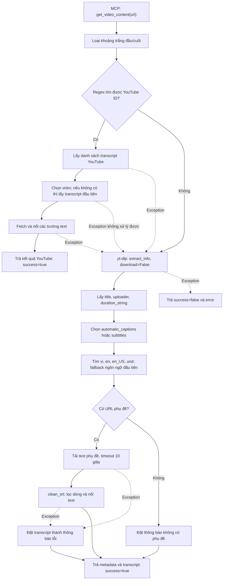

# BrainTot Video Content Extractor

Script `video_extractor_mcp.py` cung cấp MCP tool `get_video_content(url)` để lấy metadata và phụ đề có sẵn từ nguồn video.

Tài liệu này mô tả luồng xử lý trong source hiện tại. Script trả dữ liệu dạng text/dictionary, **không tải file video, không tách audio và không tạo transcript từ âm thanh**. MCP server khởi tạo với tên `video-content-extractor` và chạy qua stdio bằng `mcp.run()`.

## Đầu vào

Tool nhận một tham số:

| Tham số | Kiểu | Mô tả |
| --- | --- | --- |
| `url` | `str` | URL video; hàm nhận diện YouTube cũng nhận chuỗi ID gồm đúng 11 ký tự hợp lệ |

Ví dụ input gửi qua MCP client, thay `VIDEO_ID` bằng ID thực tế:

```json
{
  "url": "https://www.youtube.com/watch?v=VIDEO_ID"
}
```

Script loại khoảng trắng ở đầu/cuối bằng `strip()`. Hàm `extract_youtube_id()` dùng regex tìm ID sau `v=`, `youtu.be/`, `shorts/`, `embed/` hoặc `live/`; nếu không khớp thì trả `None`.

Đây là nhận diện bằng mẫu chuỗi, chưa xác thực hostname hay URL HTTP(S). Nếu truyền ID thuần và nhánh YouTube thất bại, nhánh fallback nhận nguyên chuỗi ID đó, không tự chuyển thành URL.

## Đầu ra

Hàm trả `Dict[str, Any]`. Cấu trúc phụ thuộc nhánh xử lý; các ví dụ dưới đây chỉ minh họa schema, không phải kết quả đã chạy thử.

### 1. Lấy transcript qua YouTube thành công

```json
{
  "success": true,
  "platform": "YouTube",
  "video_id": "abcdefghijk",
  "method": "youtube_transcript_api",
  "language": "en",
  "transcript": "Hello everyone. Welcome back."
}
```

`transcript` là các trường `text` được nối bằng dấu cách. Nhánh này trả ngay, không chạy yt-dlp để bổ sung tiêu đề, người đăng hoặc thời lượng. Timestamp không được đưa vào output.

### 2. Lấy metadata qua yt-dlp thành công

```json
{
  "success": true,
  "platform": "youtube",
  "title": "Example video",
  "uploader": "Example channel",
  "duration": "0:30",
  "method": "yt-dlp",
  "has_transcript": true,
  "transcript": "Hello everyone. Welcome back."
}
```

| Field | Nguồn dữ liệu / ý nghĩa |
| --- | --- |
| `platform` | `info.get('extractor', 'Unknown')` |
| `title` | `info.get('title', '')` |
| `uploader` | `info.get('uploader', '')` |
| `duration` | `info.get('duration_string', '')`, không phải số giây |
| `method` | Luôn là `yt-dlp` ở nhánh này |
| `has_transcript` | `bool(sub_url)`: đã tìm được URL phụ đề hay chưa |
| `transcript` | Text đã làm sạch, hoặc thông báo thiếu/lỗi tải phụ đề |

Các field lấy từ `info` không được chuẩn hóa kiểu hoặc xử lý giá trị `None`. Giá trị mặc định của `get()` chỉ áp dụng khi key không tồn tại.

Nếu không tìm được URL phụ đề, script vẫn trả `success=true`, với:

```json
{
  "has_transcript": false,
  "transcript": "Video không có sẵn subtitle/caption dạng text trực tiếp."
}
```

Nếu tìm được URL nhưng tải hoặc xử lý phụ đề lỗi, script vẫn trả `success=true`, `has_transcript=true`; trường `transcript` chứa `Không tải được link sub: <chi tiết lỗi>`. Hai field boolean này không xác nhận nội dung phụ đề đã được lấy thành công.

### 3. Nhánh yt-dlp phát sinh lỗi

```json
{
  "success": false,
  "error": "Chi tiết exception"
}
```

Đây là lỗi được bắt bởi `try/except` bao quanh nhánh yt-dlp. Lỗi ở nhánh YouTube bị bỏ qua để chạy fallback. Lỗi khởi động/import dependency hoặc lỗi xảy ra trước các khối `try` không được chuyển thành output này.

## Flow xử lý



Sơ đồ thể hiện các nhánh chính. Exception khác bên trong khối yt-dlp, như đọc metadata hoặc chọn phụ đề, cũng đi đến kết quả `success=false`.

### Bước 1. Nhận diện YouTube

`get_video_content()` gọi `extract_youtube_id(url)`. Hàm thử lần lượt hai regex: tìm ID trong mẫu URL, sau đó kiểm tra chuỗi ID thuần. Kết quả có ID thì thử nhánh YouTube; không có ID thì đi thẳng sang yt-dlp.

### Bước 2. Thử lấy transcript YouTube

1. Import `YouTubeTranscriptApi` và gọi `list_transcripts(yt_id)`.
2. Gọi `find_transcript(['vi', 'en'])` để tìm bản phù hợp.
3. Nếu thao tác chọn bản phù hợp lỗi, lấy phần tử đầu bằng `next(iter(transcript_list))`.
4. Gọi `fetch()`, lấy `item['text']` của mỗi phần tử và nối bằng dấu cách.
5. Trả kết quả có `method='youtube_transcript_api'` và kết thúc hàm.

Bất kỳ exception nào thoát ra trong nhánh này đều bị bỏ qua để thử yt-dlp. Code đang giả định thư viện có API `list_transcripts` và các item truy cập như dictionary; tính tương thích với phiên bản cài đặt chưa được kiểm chứng.

### Bước 3. Lấy metadata bằng yt-dlp

Script tạo `YoutubeDL` với `skip_download=True`, `writesubtitles=True`, `writeautomaticsub=True`, `subtitleslangs=['all']`, đồng thời tắt log thông thường và warning. Sau đó gọi:

```python
info = ydl.extract_info(url, download=False)
```

Ở bước này script lấy thông tin nguồn và danh sách phụ đề. Các cờ subtitle không đồng nghĩa script đã tải video hoặc ghi subtitle ra file; nội dung phụ đề được tải riêng ở bước 5.

### Bước 4. Chọn URL phụ đề

Nguồn phụ đề được chọn bằng:

```python
captions_data = info.get('automatic_captions') or info.get('subtitles') or {}
```

Nếu `automatic_captions` có dữ liệu, script dùng dữ liệu đó và không gộp thêm `subtitles`. Script tìm lần lượt `vi`, `en`, `en_US`, `und`, chọn entry đầu tiên của ngôn ngữ đầu tiên có danh sách không rỗng, rồi lấy field `url`.

Nếu vẫn không có URL, script kiểm tra entry đầu tiên của ngôn ngữ đầu tiên trong dictionary. Nó không duyệt mọi định dạng để tìm URL tốt nhất và không kiểm tra định dạng subtitle trước khi tải.

### Bước 5. Tải và làm sạch text

Nếu có `sub_url`, script tạo HTTP request với header `User-Agent: Mozilla/5.0`, đọc phản hồi bằng `urlopen(..., timeout=10)` rồi decode UTF-8 với `errors='ignore'`.

Hàm `clean_srt()` xử lý từng dòng:

1. Bỏ khoảng trắng đầu/cuối.
2. Bỏ dòng trống.
3. Bỏ dòng chỉ chứa chữ số.
4. Bỏ dòng bắt đầu bằng mẫu `HH:MM:SS`.
5. Nối các dòng còn lại bằng dấu cách.

Hàm không parse đầy đủ VTT/JSON/XML, không loại mọi markup và không giữ timestamp. Vì script lấy định dạng subtitle đầu tiên, text kết quả có thể còn dữ liệu định dạng.

### Bước 6. Trả kết quả

Nhánh yt-dlp ghép metadata và `transcript_text` vào một dictionary. Thiếu phụ đề hoặc lỗi tải phụ đề vẫn trả metadata với `success=true`. Exception thoát ra ngoài khối xử lý phụ đề nhưng còn trong khối yt-dlp trả `success=false` và chuỗi lỗi.

Mô tả trên được đối chiếu với source code; chưa phải kết quả kiểm thử với dịch vụ video thực tế.
